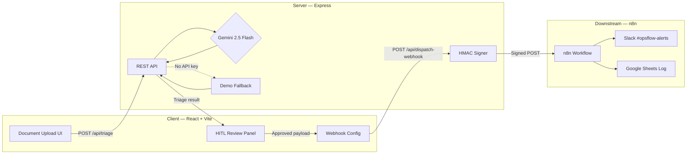
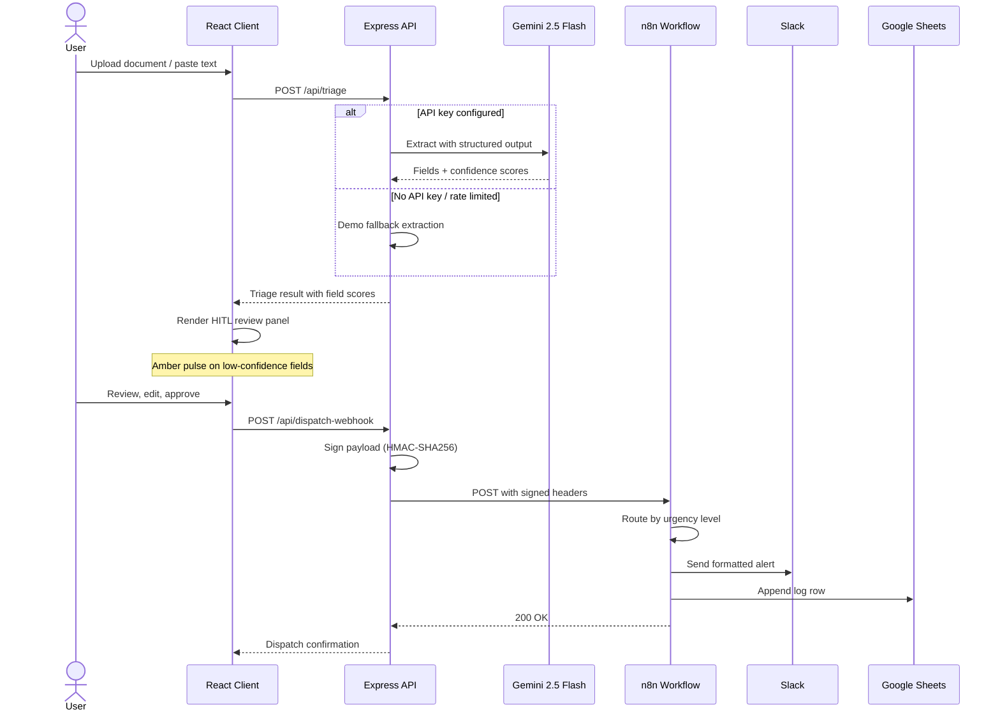
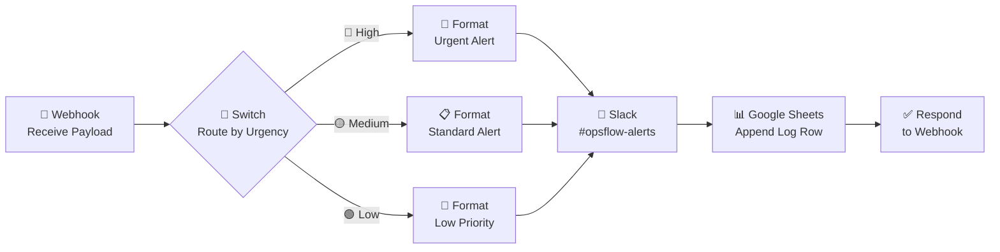

<div align="center">

# 🔷 OpsFlow AI Triage

### Enterprise AI Document Intake, Confidence Scoring & Human-in-the-Loop Webhook Engine

**Gemini 2.5 Flash** · **React + Vite** · **Express** · **n8n Webhooks**

[Live Demo](#demo) · [Quick Start](#quick-start) · [Architecture](#architecture) · [API Reference](#api-reference)

---

</div>

## Overview

OpsFlow AI Triage is an enterprise-grade document intake and triage engine that uses **Google Gemini 2.5 Flash** to extract structured data from unstructured documents — invoices, insurance claims, medical referrals, and more. It applies **field-level confidence scoring** (0–100% per field with AI reasoning), enables **human-in-the-loop review** for low-confidence extractions via an intuitive amber-pulse UI, and dispatches approved payloads via **HMAC-SHA256 signed webhooks** to downstream automation tools like n8n. When no API key is configured, the system seamlessly falls back to a deterministic demo mode so live recruiter demos never crash.

## ✨ Key Features

### 🤖 AI-Powered Extraction
- **Gemini 2.5 Flash** with structured output schema for deterministic field extraction
- Multi-format intake: file upload (PDF, PNG, JPEG, WebP, GIF, TXT) and raw text paste
- Industry-specific extraction presets with tailored prompts and field schemas

### 📊 Field-Level Confidence Scoring
- 0–100% confidence score per extracted field with AI-generated reasoning
- Overall document confidence computed from individual field scores
- Automatic triage decisions based on configurable confidence thresholds

### 👁️ Human-in-the-Loop Review
- Amber pulse animation highlights fields below the confidence threshold
- Inline field editing — reviewers can correct extractions before approval
- One-click approve/reject workflow with audit trail

### 🔐 Signed Webhook Dispatch
- HMAC-SHA256 payload signatures via `X-OpsFlow-Signature` header
- Timestamp injection via `X-OpsFlow-Timestamp` for replay protection
- Configurable webhook URLs — point at n8n, Zapier, or any HTTP endpoint

### 🔄 n8n Integration
- Ready-to-import workflow (`n8n/opsflow-intake-webhook-workflow.json`)
- Urgency-based routing → Slack notifications → Google Sheets logging
- Zero-code automation pipeline out of the box

### 🛡️ Graceful Demo Fallback
- Deterministic mock extraction mode when `GEMINI_API_KEY` is absent or rate-limited
- Portfolio visitors always see a fully functional application
- Seamless switch — same API contract, same UI, realistic demo data

### 📄 Multi-Format Intake
- Drag-and-drop file upload with progress indicators
- Raw text paste for quick testing
- Industry presets: Insurance Claims, Medical Referrals, Financial Invoices

---

## 🏗️ Architecture

### System Architecture



### Request Flow



---

## 📁 Project Structure

```
opsflow-ai-triage/
├── client/                         # React frontend (Vite)
│   ├── public/
│   │   ├── favicon.svg
│   │   └── icons.svg
│   ├── src/
│   │   ├── assets/
│   │   │   └── hero.png
│   │   ├── App.jsx                 # Main application component
│   │   ├── App.css                 # Application styles
│   │   ├── index.css               # Global styles (Tailwind)
│   │   └── main.jsx                # Entry point
│   ├── index.html
│   ├── vite.config.js
│   └── package.json
├── server/                         # Express backend
│   ├── src/
│   │   ├── middleware/
│   │   │   └── upload.js           # Multer file upload (10 MB limit)
│   │   ├── routes/                 # API route handlers
│   │   ├── services/               # Gemini + demo extraction logic
│   │   └── utils/
│   │       └── signature.js        # HMAC-SHA256 webhook signing
│   └── package.json
├── n8n/
│   └── opsflow-intake-webhook-workflow.json  # Ready-to-import n8n workflow
├── .env.example                    # Environment variable template
├── .gitignore
├── AGENTS.md                       # AI agent project rules
├── package.json                    # Root monorepo orchestration
└── README.md
```

---

## 🚀 Quick Start

### Prerequisites

| Requirement | Version | Notes |
|-------------|---------|-------|
| Node.js | >= 18 | LTS recommended |
| npm | >= 9 | Ships with Node 18+ |
| Gemini API Key | — | **Optional** — app works in demo mode without it |

### Installation

```bash
git clone https://github.com/YOUR_USERNAME/opsflow-ai-triage.git
cd opsflow-ai-triage
npm run install:all
```

### Environment Variables

Copy the example file and configure:

```bash
cp .env.example .env
```

| Variable | Required | Default | Description |
|----------|----------|---------|-------------|
| `GEMINI_API_KEY` | No | — | Google Gemini API key. Omit for demo mode. |
| `PORT` | No | `5000` | Express server port |
| `NODE_ENV` | No | `development` | Environment (`development` \| `production`) |
| `DEFAULT_WEBHOOK_URL` | No | `https://httpbin.org/post` | Fallback webhook target URL |
| `WEBHOOK_SECRET` | No | `opsflow-default-secret` | HMAC-SHA256 signing secret |

> [!TIP]
> Get a free Gemini API key at [aistudio.google.com](https://aistudio.google.com/apikey). The app works without one — it falls back to realistic demo data.

### Running

```bash
# Start both client & server concurrently
npm run dev

# Server only (http://localhost:5000)
npm run dev:server

# Client only (http://localhost:5173)
npm run dev:client
```

> [!NOTE]
> The client dev server proxies `/api` requests to the Express server on port 5000.

---

## 🔌 API Reference

### `POST /api/triage`

Extract structured data from a document using Gemini AI or the demo fallback.

**Request** — `multipart/form-data` or `application/json`

| Field | Type | Description |
|-------|------|-------------|
| `file` | `File` | Uploaded document (PDF, PNG, JPEG, WebP, GIF, TXT). Max 10 MB. |
| `text` | `string` | Raw text to triage (alternative to file upload) |
| `preset` | `string` | Industry preset: `insurance`, `medical`, `financial` |

**Response** — `200 OK`

```json
{
  "success": true,
  "mode": "gemini",
  "triage": {
    "fields": [
      {
        "label": "Customer Name",
        "value": "Acme Corp",
        "confidence": 95,
        "reasoning": "Clearly stated in document header"
      },
      {
        "label": "Amount",
        "value": "$12,450.00",
        "confidence": 88,
        "reasoning": "Extracted from line item total"
      },
      {
        "label": "Category",
        "value": "Equipment Purchase",
        "confidence": 72,
        "reasoning": "Inferred from item descriptions"
      }
    ],
    "overallConfidence": 85,
    "urgencyLevel": "medium",
    "autoApproved": false,
    "summary": "Invoice from Acme Corp for equipment purchase totaling $12,450.00"
  }
}
```

### `POST /api/dispatch-webhook`

Dispatch an approved triage payload to a configured webhook endpoint with HMAC-SHA256 signature.

**Request** — `application/json`

| Field | Type | Description |
|-------|------|-------------|
| `webhookUrl` | `string` | Target URL (overrides `DEFAULT_WEBHOOK_URL`) |
| `triage` | `object` | The approved triage payload to dispatch |

**Response** — `200 OK`

```json
{
  "success": true,
  "dispatch": {
    "url": "https://your-n8n.example.com/webhook/opsflow-intake",
    "status": 200,
    "timestamp": "2024-11-01T12:00:00.000Z",
    "signature": "a1b2c3d4..."
  }
}
```

**Signed Headers Sent to Webhook:**

| Header | Description |
|--------|-------------|
| `X-OpsFlow-Signature` | HMAC-SHA256 hex digest of the JSON body |
| `X-OpsFlow-Timestamp` | ISO 8601 timestamp of dispatch |
| `Content-Type` | `application/json` |

### `GET /api/health`

Health check endpoint.

**Response** — `200 OK`

```json
{
  "status": "ok",
  "timestamp": "2024-11-01T12:00:00.000Z",
  "gemini": true
}
```

---

## 🔄 n8n Integration

OpsFlow ships with a ready-to-import n8n workflow that automates post-approval processing.

### n8n Workflow Pipeline



### Setup Steps

#### 1. Import the Workflow

1. Open your n8n instance
2. Go to **Workflows** → **Import from File**
3. Select `n8n/opsflow-intake-webhook-workflow.json`
4. The workflow **"OpsFlow AI Triage — Intake Webhook Pipeline"** will appear

#### 2. Configure Slack Credentials

1. Open the **"Send Slack Notification"** node
2. Click the credential dropdown → **Create New**
3. Add your Slack Bot Token (with `chat:write` scope)
4. Ensure your bot is invited to `#opsflow-alerts`

#### 3. Configure Google Sheets Credentials

1. Open the **"Log to Google Sheets"** node
2. Click the credential dropdown → **Create New**
3. Authenticate with your Google account (OAuth2)
4. Create a Google Sheet with columns: `Timestamp`, `Customer Name`, `Category`, `Urgency`, `Confidence`, `Auto-Approved`, `Amount`
5. Copy the Sheet ID from the URL and paste it into the node

#### 4. Activate & Copy the Webhook URL

1. Toggle the workflow **Active**
2. Open the **"Receive Triage Payload"** node
3. Copy the **Production Webhook URL** (e.g., `https://your-n8n.example.com/webhook/opsflow-intake`)

#### 5. Connect OpsFlow

Paste the n8n webhook URL into OpsFlow's webhook configuration field, or set it as `DEFAULT_WEBHOOK_URL` in your `.env`:

```env
DEFAULT_WEBHOOK_URL=https://your-n8n.example.com/webhook/opsflow-intake
```

> [!IMPORTANT]
> Make sure your `WEBHOOK_SECRET` matches between OpsFlow and any n8n signature verification you add. The default is `opsflow-default-secret` — change it in production.

---

## 🎯 Industry Presets

OpsFlow includes three industry presets that tailor extraction prompts and field schemas:

| Preset | Scenario | Key Fields | Typical Urgency |
|--------|----------|------------|-----------------|
| 🏥 **Insurance Claim** | Policyholder submits a damage claim with photos and a description | Policyholder Name, Claim Amount, Damage Type, Policy Number, Date of Incident | High (large claims) / Medium |
| 🩺 **Medical Referral** | Doctor refers a patient to a specialist with clinical notes | Patient Name, Referring Physician, Diagnosis, Specialist Type, Priority Level | High (urgent care) / Low |
| 💰 **Financial Invoice** | Vendor submits an invoice for payment processing | Vendor Name, Invoice Amount, Line Items, Due Date, PO Number | Medium / Low |

Each preset provides:
- **Tailored extraction prompt** optimized for the document type
- **Field schema** with expected labels, types, and validation hints
- **Urgency heuristics** based on extracted values (e.g., claim amount > \$10,000 → high)

---

## 🚢 Deployment

### Frontend → Vercel

1. **Push to GitHub** — ensure your repo is on GitHub

2. **Import in Vercel**
   ```
   https://vercel.com/new → Import Git Repository
   ```

3. **Configure Build**
   | Setting | Value |
   |---------|-------|
   | Framework Preset | Vite |
   | Root Directory | `client` |
   | Build Command | `npm run build` |
   | Output Directory | `dist` |

4. **Set Environment Variables** (if the client needs any)

5. **Deploy** — Vercel auto-deploys on push to `main`

### Backend → Render

1. **Create a Web Service** at [render.com](https://render.com)

2. **Configure**
   | Setting | Value |
   |---------|-------|
   | Root Directory | `server` |
   | Build Command | `npm install` |
   | Start Command | `npm start` |
   | Environment | Node |

3. **Set Environment Variables**
   ```
   GEMINI_API_KEY=your-key-here
   NODE_ENV=production
   WEBHOOK_SECRET=your-production-secret
   DEFAULT_WEBHOOK_URL=https://your-n8n.example.com/webhook/opsflow-intake
   ```

4. **Deploy** — Render auto-deploys on push to `main`

> [!WARNING]
> Always change `WEBHOOK_SECRET` from the default value in production deployments. Use a strong random string (32+ characters).

---

## <a id="demo"></a>🎬 Demo

> The live demo runs in **demo mode** (no API key required). All extractions use realistic deterministic data so every feature is fully explorable.

1. Visit the deployed URL
2. Choose an industry preset or upload/paste a document
3. Review the AI extraction with confidence scores
4. Edit any low-confidence fields (amber pulse indicators)
5. Approve the triage and dispatch via webhook
6. Check Slack / Google Sheets for the automated output

---

## 📄 License

This project is licensed under the [MIT License](LICENSE).

---

## 🙏 Acknowledgments

| Technology | Role |
|-----------|------|
| [Google Gemini](https://ai.google.dev/) | AI-powered document extraction engine |
| [n8n](https://n8n.io/) | Workflow automation and webhook orchestration |
| [React](https://react.dev/) | Frontend UI framework |
| [Vite](https://vite.dev/) | Frontend build tooling |
| [Tailwind CSS](https://tailwindcss.com/) | Utility-first styling |
| [Lucide](https://lucide.dev/) | Icon library |
| [Express](https://expressjs.com/) | Backend HTTP framework |

---

<div align="center">

Built with ❤️ and Gemini AI

</div>
